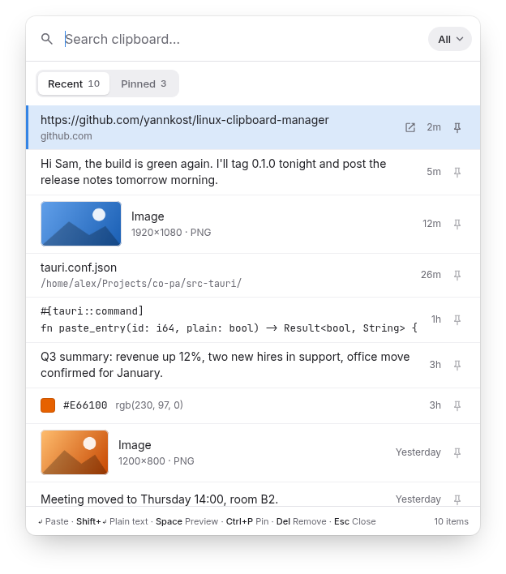
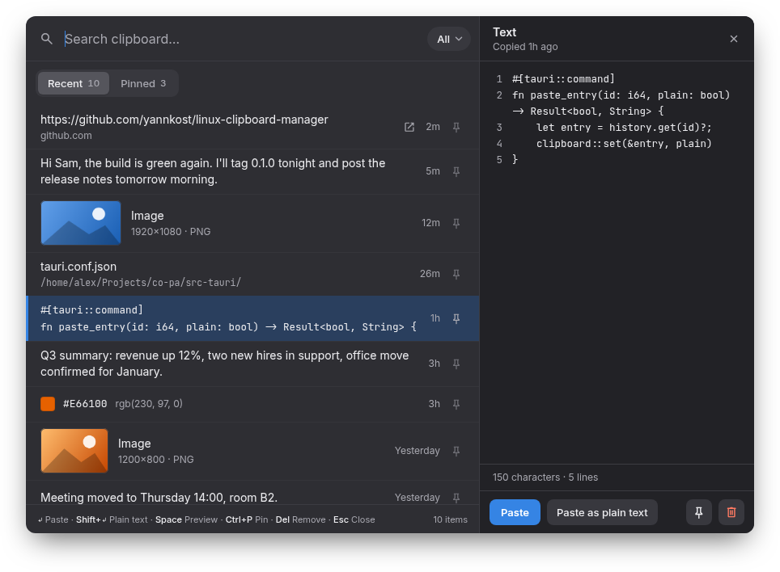
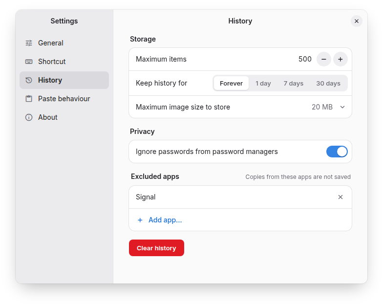

# Co-Pa

**Co-Pa** (short for *copy-paste*) is a clipboard history manager for Linux,
inspired by [Ditto](https://ditto-cp.sourceforge.io/) on Windows. It remembers
everything you copy, text and images, and brings it back with one shortcut.

It is built for **GNOME on Wayland** (Ubuntu, Zorin OS, Fedora Workstation, …),
where most clipboard managers struggle because Wayland does not let normal apps
watch the clipboard or type into other windows.



## Features

- **Searchable history** of text and images, opened with <kbd>Ctrl</kbd>+<kbd>I</kbd> (configurable).
- **Auto-paste**: pick an entry and it is pasted straight into the window you were working in.
- **Pinned items** that never expire, in their own tab.
- **Preview panel** with the full text (line numbers) or the full image, plus Copy / Save as… / Open.
- **Smart rows**: links (with an open button), file paths, colours with a swatch, code and images are recognised.
- **Multi-select** to paste or delete several entries at once.
- **Privacy**: skips passwords copied from password managers, and copies from apps you exclude.
- **Limits**: maximum number of entries, maximum image size, and optional expiry after 1, 7 or 30 days.
- **Tray icon** with pause recording, **autostart** at login, light and dark themes.



## Install

### From the .deb (Ubuntu 24.04+, Zorin OS 18, Debian-based)

Download `Co-Pa_<version>_amd64.deb` from the
[latest release](https://github.com/yannkost/linux-clipboard-manager/releases/latest), then:

```bash
sudo apt install ./Co-Pa_*_amd64.deb
```

Start **Co-Pa** from the app menu once. It then:

1. starts automatically at every login (hidden in the tray),
2. creates the GNOME keyboard shortcut <kbd>Ctrl</kbd>+<kbd>I</kbd>,
3. shows a welcome dialog with an **Enable extension** button. Click it, then
   **log out and back in once** (GNOME only loads new extensions at login).

After that, auto-paste works (turn it on in Settings → Paste behaviour).
Without the extension Co-Pa still records your history and puts the chosen
entry on the clipboard; you then paste with <kbd>Ctrl</kbd>+<kbd>V</kbd> yourself.

### From source

```bash
# Build dependencies (Debian/Ubuntu package names)
sudo apt install build-essential pkg-config libwebkit2gtk-4.1-dev \
  libayatana-appindicator3-dev librsvg2-dev libssl-dev libxdo-dev
# Rust, if you don't have it: https://rustup.rs
git clone https://github.com/yannkost/linux-clipboard-manager.git
cd linux-clipboard-manager
scripts/install.sh
```

`scripts/install.sh` builds a release binary, installs it to
`~/.local/bin/linux-clipboard-manager` with a menu entry and icons, and
(re)starts it. Run it again to update.

To build the .deb yourself: `cargo install tauri-cli --version "^2" --locked`,
then `cd src-tauri && cargo tauri build --bundles deb`.

## Using it

| Key | Action |
|---|---|
| <kbd>Ctrl</kbd>+<kbd>I</kbd> | open / close the popup |
| type | search |
| <kbd>↑</kbd> <kbd>↓</kbd>, <kbd>PgUp</kbd> <kbd>PgDn</kbd> | move |
| <kbd>Enter</kbd> or click | paste |
| <kbd>Shift</kbd>+<kbd>Enter</kbd> or <kbd>Shift</kbd>+click | paste as plain text |
| <kbd>Ctrl</kbd>+<kbd>1</kbd>…<kbd>9</kbd> | paste that row |
| <kbd>Tab</kbd> | switch Recent / Pinned |
| <kbd>Ctrl</kbd>+<kbd>P</kbd> or the pin button | pin / unpin |
| <kbd>Del</kbd> | remove |
| <kbd>Space</kbd>, <kbd>→</kbd> / <kbd>←</kbd> | open / close the preview |
| <kbd>Ctrl</kbd>+click, <kbd>Shift</kbd>+<kbd>↑</kbd><kbd>↓</kbd> | multi-select (Enter pastes all, Del removes all) |
| <kbd>Ctrl</kbd>+<kbd>,</kbd> | settings |
| <kbd>Esc</kbd> | close preview, clear selection, clear search, then close |

Settings are in the tray menu (or <kbd>Ctrl</kbd>+<kbd>,</kbd>) and apply immediately.



## How it works, and why

| Part | What | Why |
|---|---|---|
| App | [Tauri 2](https://tauri.app/): Rust backend (`src-tauri/`), plain HTML/CSS/JS UI (`ui/`, no build step) | Small native binary using the system's WebKitGTK; Rust for the clipboard, storage and D-Bus work. |
| Storage | SQLite via `rusqlite`, images as PNG files next to it | Fast search and de-duplication (SHA-256), everything stays local. |
| Settings | TOML file | Human-readable; the Settings window edits it for you. |
| Shortcut | A GNOME custom shortcut running `linux-clipboard-manager --toggle` | Wayland apps cannot grab global keys, GNOME can. Changing the shortcut in Co-Pa updates it and warns about conflicts. |
| GNOME extension | `gnome-extension/clips-helper@yannkost.github.io`, bundled inside the app | On Wayland only GNOME Shell may see every clipboard change and type into other windows. The extension reports copies (with the source app and password marker) and performs the paste. |
| Fallback | Polling the clipboard every 500 ms with [`arboard`](https://github.com/1Password/arboard) through XWayland | Keeps history working before the extension is enabled. |
| Messaging | D-Bus via `zbus` | The desktop's standard local messaging; no network ports. |
| Tray, autostart, single instance | Tauri tray (AppIndicator), `tauri-plugin-autostart`, `tauri-plugin-single-instance` | A second launch (shortcut, menu) talks to the running instance instead of starting another one. |

### D-Bus interface

Co-Pa owns `io.github.yannkost.ClipboardManager` at `/io/github/yannkost/ClipboardManager`:

| Member | |
|---|---|
| `Toggle()` | show / hide the popup |
| `AddText(s)`, `AddImage(ay png)` | record content |
| `AddTextFrom(s text, s app_name, s app_id, b password)`, `AddImageFrom(ay image, s app_name, s app_id)` | used by the extension; honours the privacy settings |
| `Hotkey` (property) | configured shortcut |

The extension exports `io.github.yannkost.ClipboardManager.Shell` on GNOME
Shell's connection at `/io/github/yannkost/ClipboardManager/Shell`:
`SetText(s)`, `SetImage(ay)`, `Paste(b plain)` (refocuses the previous window
and sends <kbd>Ctrl</kbd>+<kbd>V</kbd>, or <kbd>Ctrl</kbd>+<kbd>Shift</kbd>+<kbd>V</kbd>
in terminals) and `Version()`.

### Files it writes

- `~/.local/share/linux-clipboard-manager/`: history database and images
- `~/.config/linux-clipboard-manager/config.toml`: settings
- `~/.config/autostart/Co-Pa.desktop`: login autostart (toggle in Settings)
- `~/.local/share/gnome-shell/extensions/clips-helper@yannkost.github.io/`: the extension, once enabled
- a GNOME custom shortcut in *Settings → Keyboard → Custom Shortcuts*

## Development

```bash
cd src-tauri
cargo test     # database, config, shortcut parsing, …
cargo build    # debug build: target/debug/linux-clipboard-manager
```

Edits in `ui/` are picked up by the next `cargo build`. Pushing a `v*` tag
builds the .deb on GitHub Actions and attaches it to a release.

## License

Co-Pa is released under the [MIT License](LICENSE).

## Credits

UI fonts: [Inter](https://rsms.me/inter/) and
[JetBrains Mono](https://www.jetbrains.com/lp/mono/) (SIL Open Font License),
and a subset of [Material Symbols Rounded](https://fonts.google.com/icons)
(Apache License 2.0).
